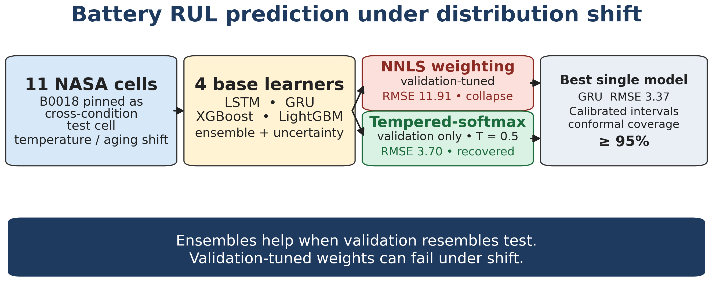

# Heterogeneous Ensemble Deep Learning with Uncertainty Quantification for Lithium-Ion Battery RUL Prediction

Reproducibility repository for the research paper *"Heterogeneous Ensemble Learning with Uncertainty Quantification for Lithium-Ion Battery Remaining-Useful-Life Prediction under Operating-Condition Shift"* (conference version prepared for SPERT 2027, IEEE; full journal version in preparation for the Journal of Energy Storage).



## What this repo contains

| Path | Contents |
|---|---|
| `src/battery_rul_colab_v2.py` | Full experiment pipeline: NASA .mat parsing, feature engineering, LSTM/GRU/XGBoost/LightGBM training, NNLS ensemble stacking, MC-Dropout uncertainty quantification, figures + tables |
| `notebooks/battery_rul_colab_v2.ipynb` | Same pipeline as a Colab notebook (training runs A/B/C were executed in Google Colab) |
| `data/` | How to download every dataset used (scripts + inventory); raw data is **not** committed |
| `experiments/run_a_4cell/` | Run A (4 NASA cells): ensemble wins, RMSE 4.89 |
| `experiments/run_b_7cell/` | Run B (7 NASA cells): distribution-shift ablation, RMSE 7.33 |
| `experiments/run_c_11cell/` | Run C (11 NASA cells): GRU best at RMSE 3.37; validation-tuned ensemble collapses to 11.91 — full tables, figures, run metadata |
| `experiments/oxford_cross_dataset/` | Cross-dataset validation on the independent Oxford dataset — completed, honest negative result (naive transfer loses to the fade-fraction baseline in both directions) |
| `experiments/shift_robust_stacking/` | Shift-robust ensemble weighting experiments — completed (tempered-softmax T=0.5 recovers to 3.70 on B0018; minimax-regret 4.47; weighted conformal 100% coverage at double interval width) |
| `EXPERIMENTS.md` | Complete experiment record: protocol, findings, discussion, observations |

## The headline story

Three sequential runs share **one pinned test cell (B0018, a constant-2A discharge cell, like the training cells B0005/B0006/B0007)**. The supported shift axis is the **temperature/aging-regime shift between validation and test cells** — not discharge rate (the 4A-pulse cells, B0033/B0034, sit in the training set) — so every run is a genuine cross-condition generalization test, and the runs are directly comparable.

| Run | Train cells | Test (B0018, n=83) | Key result |
|---|---|---|---|
| A — 4 cells | B0005, B0007 | Ensemble RMSE **4.89**, R² 0.53 | Ensemble significantly beats best single model (XGBoost 5.37; paired t-test p=0.015) |
| B — 7 cells | + B0042/43/44 | Ensemble RMSE **7.33**, R² −0.05 | Adding short-lived cells *hurts* — more data is not better under regime shift |
| C — 11 cells | + B0033/34/55 (+formation trim) | GRU RMSE **3.37**, R² 0.78; ensemble **11.91** | GRU improves monotonically with data (6.59→5.23→3.37); validation-tuned NNLS weights collapse under the temperature/aging-regime shift |

Uncertainty: raw MC-Dropout 95% intervals cover only 27.7% of test targets (severely overconfident); validation-fit variance scaling lifts coverage to 81.9%.

## Reproduce

```bash
pip install -r requirements.txt
# 1. Download data (see data/README.md) into data/nasa/
python src/battery_rul_colab_v2.py --data_dir data/nasa --config run_c
```

All splits are by **cell ID** (no cell appears in two splits), `StandardScaler` is fit on train only, and features use past/current cycles only — see `experiments/run_c_11cell/run_metadata.json` for the full leakage-control list and hyperparameter config (seed 42).

## Datasets

- **NASA PCoE Battery Data Set** (primary): https://phm-datasets.s3.amazonaws.com/NASA/5.+Battery+Data+Set.zip — 34 cells; 11 usable after formation-trim + censoring (see `data/README.md`)
- **Oxford Battery Degradation Dataset 1** (independent cross-dataset validation): DOI `10.5287/bodleian:KO2kdmYGg` — 8 Kokam 740 mAh pouch cells, 40 °C, Artemis Urban drive cycles
- **Kaggle cleaned NASA** (`mystifoe77/nasa-battery-data-cleaned`): derivative of NASA — used only for impedance/temperature feature enrichment, never as an independent dataset
- **CALCE SP1/SP3**: characterization-only OCV data, excluded from RUL training

## Research gap

No directly comparable study was identified in the reviewed literature that asks whether **validation-tuned ensemble weights survive an operating-condition shift** in battery RUL prediction — ensemble papers report in-distribution gains, uncertainty papers evaluate in-distribution, and shift papers focus on transfer learning rather than ensemble-weight robustness. This repo documents the empirical evidence for that gap.

## Status

Manuscript v2.14. A 6-page IEEE conference version has been prepared for SPERT 2027 (SVNIT Surat; submission deadline 15 December 2026). The full journal manuscript is in preparation for the Journal of Energy Storage, with submission planned for February 2027. All experiment tracks in this repo are complete.

## Contact

Aakash Mehta — aakashmehta108@gmail.com
